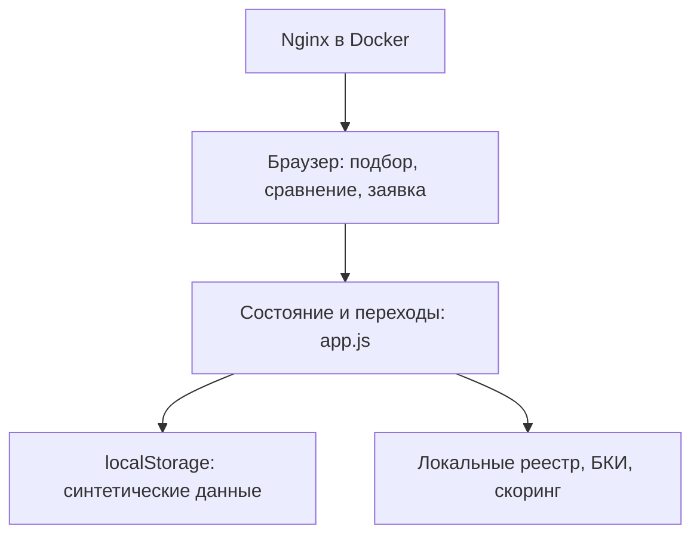
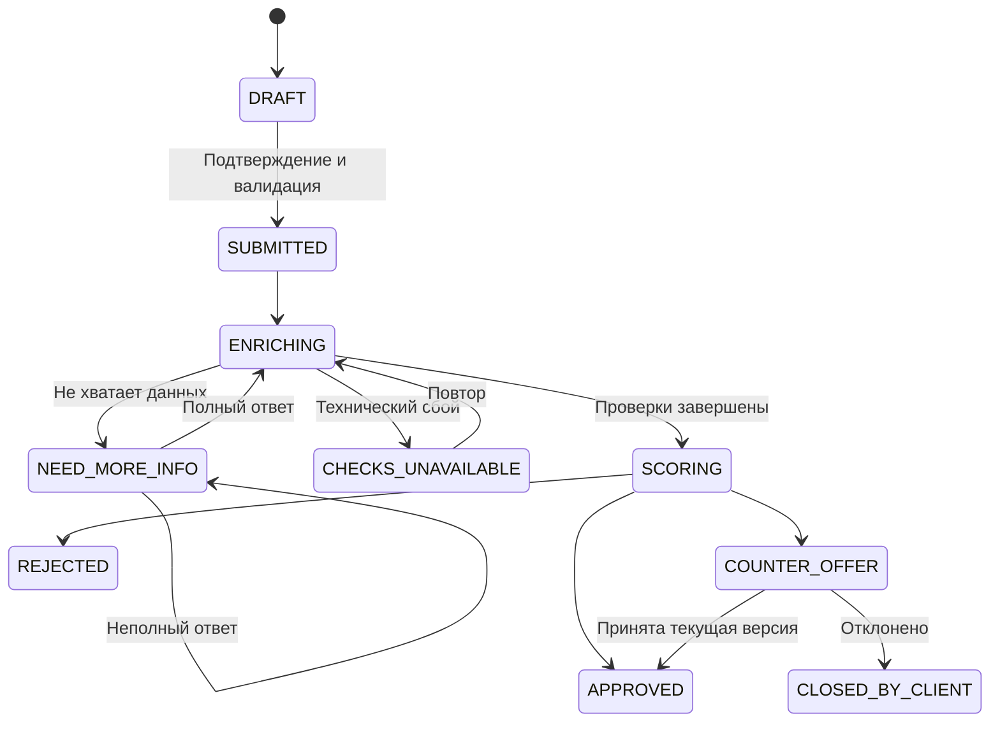

# Архитектура frontend MVP

В production команда должна перенести состояние, проверки и принятие решений на сервер. Предлагаемый REST-контракт — openapi.yaml. Сервер не реализован в этом frontend MVP. Отдельная банковская панель находится вне объёма работы.

Ошибки полей сохраняют DRAFT. Отсутствие подходящего продукта происходит до заявки и не является REJECTED. После отказа или закрытия новый подбор создаёт новый DRAFT. Отдельная оценка риска содержит свободный поток и покрытие платежа. Кредитные правила затем учитывают возраст бизнеса, продукт, минимальную сумму и результаты тестового БКИ. Одобрение не означает подписание или выдачу денег.
